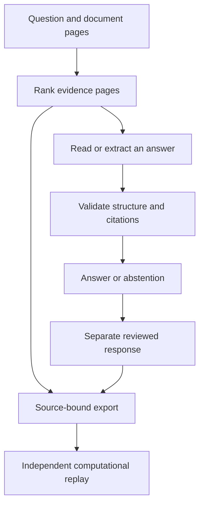

# LAVA · Multilingual Document Intelligence

**Alvaro Mendizabal · Retrieval · Document QA · Evaluation · AWS GPU engineering**

[](https://github.com/alvaromendizabal/lava-aws-multilingual-docvqa/actions/workflows/ci.yml)


I built an **Applied ML research system** that answers questions from Japanese and Vietnamese PDFs and returns the physical pages supporting each answer. My work covers page retrieval, vision-language reading, structured output validation, model comparison and recovery from interrupted GPU runs.

**Engineering ownership:** I designed the research workflow, implemented the document-processing and answer-validation interfaces, evaluated reader configurations, and built checkpointed AWS execution. The public review connects those decisions to inspectable code, recorded measurements and an interactive evidence viewer.

**Historical recorded best: 0.49 public / 0.53 private.** The later diagnostic scored 0.48 / 0.49 and was not an improvement. I kept retrieval quality, answer quality, citation validity and operational completeness separate throughout the evaluation.

**[Open Document Desk](https://alvaro-document-evidence.tartmacaw2.chatgpt.site)** · [Read the case study](docs/case_study.md) · [Run the public review](review/README.md#one-command-an-inspectable-result) · [Architecture](docs/architecture.md)

## Review the system

| Inspect | Working implementation | Evidence |
|---|---|---|
| Finding the right physical page | [Retrieval pipeline](src/lava/retrieval/pipeline.py) | [Retrieval tests](tests/unit/test_retrieval_pipeline.py) and [aggregate report](reports/retrieval/summary.json) |
| Structured answers and citations | [Parser and validator](src/lava/readers/structured_output.py) | [Malformed-response tests](tests/unit/test_structured_output.py) |
| Reproduction after export or human review | [Browser export replay](tools/replay_public_demo.mjs) | [Changed-answer, source and receipt rejection](tools/test_replay_public_demo.mjs) |
| Recovery after interrupted work | [Per-question checkpoints](src/lava/readers/checkpoints.py) | [Recovery case study](docs/reliability_recovery.md) |
| Failure analysis | [Visible challenge evaluator](tools/evaluate_public_challenges.mjs) | [All 24 authored cases, including five misses](docs/PUBLIC_CHALLENGES.md) |



The public browser path uses lexical retrieval and extraction. The historical research path adds the separately evaluated vision-language readers documented below.

## Try Document Desk

[Open the public demo](https://alvaro-document-evidence.tartmacaw2.chatgpt.site) without installation. To run the same source locally, open `public-demo/index.html` from a checkout, or serve the checkout:

```bash
python -m http.server 8000
```

Visit `http://localhost:8000/public-demo/`. Ask a question about the authored Japanese or Vietnamese document, change retrieval settings and inspect the selected pages. The browser ranks pages with BM25, selects an extractive answer, highlights its copied support and validates the physical-page citation. Unsupported queries can abstain; the result is exportable.

This is actual lexical retrieval and extractive answering over synthetic documents, with no LLM, OCR service, backend or model download. The lexical support measure is not calibrated confidence. The historical research used a separate multimodal reading stack.

```bash
node tools/test_public_demo.mjs
```

**Inspect the failure boundary:** the [executable challenge review](docs/PUBLIC_CHALLENGES.md) runs 24 visible authored questions through this exact engine. It shows why correct page retrieval and valid citations can still produce unsupported answers, with per-language results, all five diagnostic misses, a printable report, and source-bound CI verification.

## Replay an exported answer

The browser and CLI use one export implementation. Replay verifies retrieval, source passages, physical-page citations and separate human edits against the actual shipped engine:

```bash
node tools/replay_public_demo.mjs --output /tmp/document-replay
node tools/replay_public_demo.mjs --output /tmp/document-replay --check
```

Add `--input your-export.json` with a new output directory to check a browser download. The bundle contains the export, source/runtime receipt and SHA-256 manifest. [Replay methods and failure tests](docs/DEMO_REPLAY.md) explain the computational guarantee and its semantic limits.

## Research evidence

| Measured result | Scope |
|---|---|
| Citation-guided reread: **67.57% → 77.99% local LAVA** | Reused 16-question/five-PDF development panel |
| Original heterogeneous route: **82.68% local LAVA** | Original frozen route with document-held-out selection; not the later recovered composite |
| Evidence recall@5: **98.44%** | Retrieval only on the same small development panel |
| **1,081** preserved checkpoints | Byte-identical in the recorded AWS closeout |

Local and organizer scores use different populations and runtimes. The recovered candidate has **622 structurally accepted predictions out of 624**, with two unresolved answers. Structural acceptance is not factual correctness. The historical best used two template-derived values without verified support; the diagnostic used two compatibility abstentions. [Complete evidence and limits](docs/submission_closeout.md)

## What I built

- **Separated evaluation stages:** evidence retrieval, supplied-evidence reading and complete answer/citation behavior.
- **A focused reader pipeline:** citation-guided rereading and document-level routing with explicit evaluation boundaries.
- **Reliable execution:** per-question checkpoints, source/model/input identities, failure diagnostics and verified saved notebooks.
- **Inspectable interfaces:** typed outputs, citation bounds, public parsing utilities, tests and an interactive evidence viewer.

[Architecture](docs/architecture.md) · [Case study](docs/case_study.md) · [Recovery design](docs/reliability_recovery.md)

## Run public Python checks

Python 3.12; these standard-library commands need no model or account:

```bash
python3 examples/run_demo.py
python3 examples/verify_submission_closeout.py
```

The first exercises supplied-response parsing and citation checks. The second verifies aggregate closeout consistency. For the pinned research environment and notebook checks:

```bash
uv sync --frozen --group judge
make quality
make notebooks
```

[Verification levels](docs/reproducibility.md) explain the additional requirements for model-backed evaluation. These instructions concern running this project's components and checking its evidence.

## Scope and limitations

This release contains implemented research, executable public demos and dated evidence. The small reused development panel limits generalization claims; the two unresolved answers remain unresolved. Production service quality is not claimed.

The private full-test and competition layer is intentionally excluded: source documents, predictions, generations, exact routing rules, model caches, credentials and cloud object locations remain private. Historical notebook outputs are preserved. [Project closeout](docs/submission_closeout.md) · [Executed research guide](notebooks/README.md)

## Integrated project review

| Notebook | Review focus |
|---|---|
| [From PDF to evidence-grounded answer](notebooks/05_end_to_end_system_evaluation.ipynb) | Selected 9B reader, first-pass/reread metrics, every error category and recovery contracts |

The public checkout contains the selected approach, its measured control comparison and runnable component checks. The public review requires no account or cloud data; full-test inputs and model artifacts are not distributed.
